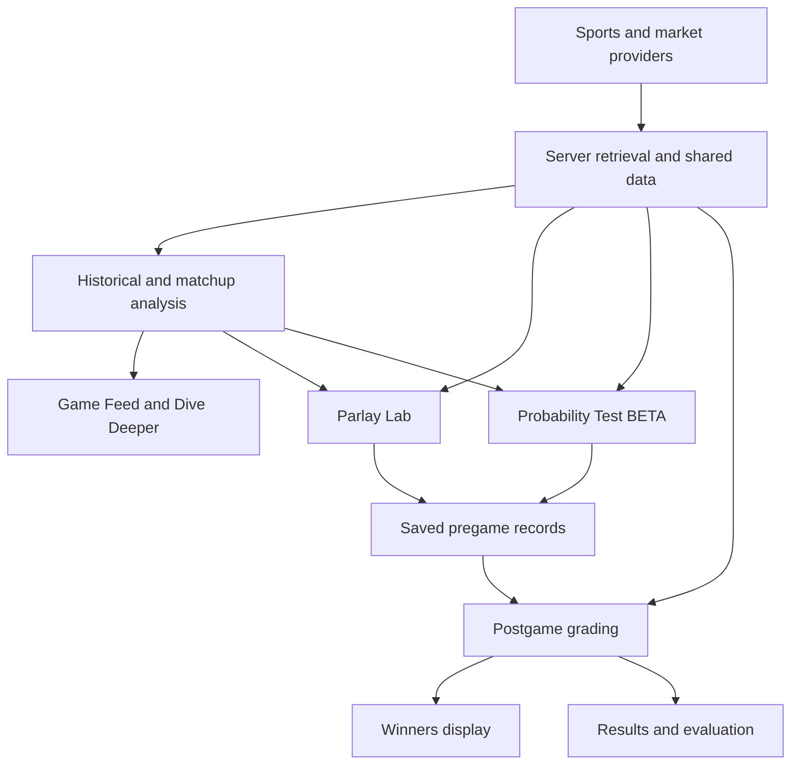

# CourtsEdge Architecture and Shared Data

CourtsEdge connects NBA and NFL data retrieval, historical analysis, interactive exploration, sportsbook market matching, and saved-result grading.

This guide describes the application at a functional level. Production source code, credentials, and underlying datasets remain private. The public repository contains documentation and a separate runnable synthetic analysis example.

## Server and Interface

The private application retrieves data and analytical results from the server for presentation in the beta interface.

Moving data retrieval and application logic to the server reduces the amount of implementation and underlying data delivered to testers' browsers.

Information displayed in a browser can still be inspected or copied. Server-side processing protects private implementation details; it does not make displayed information inaccessible.

## Shared Data Across Features

Sports statistics, game information, sportsbook markets, and relevant contextual data support multiple application features.

The same player and matchup context connects the Game Feed, Dive Deeper, Parlay Lab, simulations, and Probability Test.

Saved selections then connect pregame analysis with postgame results.

The following diagram shows functional relationships rather than a database schema or deployment topology.

Users can open features directly. The diagram does not imply that every user must follow one fixed sequence.

## Shared Refresh Architecture

Provider requests are coordinated through shared server data rather than independently retrieving the same information for every user.

The props workflow combines broad scheduled refreshes with smaller targeted updates near game time.

The documented schedule is:

| Process | Schedule or limit | Purpose |
| --- | --- | --- |
| Broad props refresh | Midnight and noon Eastern | Refresh markets across games |
| Additional Sunday refreshes | 11 a.m., 1 p.m., 3 p.m., and 7 p.m. Eastern | Refresh around Sunday game windows |
| Targeted update process | Every minute, up to 12 props per run | Prioritize games approaching their start |
| Refresh All Props | Shared limit of twice daily | Manual fallback available to users |

The targeted batch size is not a claim that every market refreshes every minute.

A manual refresh updates shared data for users. Its allowance is global rather than a separate allowance for each person.

## Availability and Freshness

Sportsbook markets become available at different times. A later-week game may have limited props early in the week and more markets closer to its start.

Refreshing can retrieve published markets; it cannot create a market that a provider has not supplied.

Quote age and update timestamps help users distinguish saved data from current sportsbook availability. Scheduled retrieval does not guarantee that every stored price matches a sportsbook at every moment.

## Matching Context Across Sources

Analytical workflows connect players, teams, games, statistical categories, and sportsbook markets.

Market identity includes the sportsbook, event, player, category, side, and threshold. Different thresholds represent different events even when the player and statistical category match.

The exact provider mappings and internal storage schema are implementation details outside this public guide.

## Game Eligibility and Results

Game status affects how information is used.

Before a game starts, eligible markets can support generation and replacement selections.

Once the game starts, it is excluded from new pregame generation. Previously saved selections remain available for subsequent grading.

After results are finalized, the grading process compares actual performance with the stored selection and threshold.

## Preserving Prediction Context

Saved records connect selections with their original sportsbook, strategy, thresholds, and available analytical context.

Later games, changing prices, or updated averages must not silently replace the original prediction context.

The results guide explains finalized-ticket save boundaries, X-factor snapshots, grading, and the distinction between Winners presentation and complete performance evaluation.

## Experimental Evaluation

Probability Test remains an active beta.

Its experimental estimates share relevant application data while remaining distinct from observed historical frequencies.

Calibration improvements, automated evaluation metrics, and model comparisons remain ongoing work. The presence of a data pipeline or saved predictions does not itself establish predictive validity.

## Related Guides

- [Parlay Lab](parlay-lab.md)
- [Dive Deeper](dive-deeper.md)
- [Probability Test BETA](probability-test.md)
- [Results Tracking and Winners](results-tracking.md)
