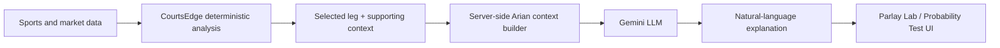

# Arian AI — Grounded LLM Explanation Layer

Arian AI is the large-language-model explanation layer in the private CourtsEdge application. It uses the Gemini API to turn supporting CourtsEdge analysis into concise natural-language commentary for selected legs in Parlay Lab and Probability Test.

The core design principle is simple:

> **CourtsEdge calculates; Arian interprets.**

Arian does not replace CourtsEdge's historical calculations, selection rules, probability baseline, sportsbook matching, or grading logic. Those workflows remain separate from the LLM.

## Why the LLM Layer Exists

CourtsEdge already produces structured analytical context such as historical hit rates, sample sizes, recent performance, averages, matchup history, thresholds, and other available supporting signals. A raw collection of numbers can still require interpretation.

Arian receives the existing supporting context for a selected leg and explains which factors strengthen, weaken, or limit the case. The goal is explanation and synthesis, not a second hidden prediction model.

## Functional Flow

The diagram is conceptual. Production prompts, internal schemas, credentials, and application source code are intentionally excluded from this public showcase.

## Grounding and Boundaries

Arian is designed to explain data that CourtsEdge already calculates or stores server-side. Depending on the selected leg and available evidence, that context can include:

- player, team, opponent, market, side, and threshold
- historical qualifying results and sample size
- recent-game performance and averages
- opponent-specific history when available
- current-season or strategy-specific context
- applicable Probability Test outputs
- limitations such as small samples, missing context, or stale data

The LLM should not invent missing statistics, silently substitute a different threshold, or present unsupported claims as calculated facts.

## Relationship to Probability Test

Probability Test remains a separate experimental quantitative workflow. Its model estimates are produced by CourtsEdge's documented methodology rather than by Gemini.

Arian may explain the supporting context around a Probability Test selection, but the LLM is not the source of the stored probability estimate, fair odds, market-implied probability, edge calculation, or postgame grade.

This separation keeps quantitative outputs reproducible and makes the role of the LLM easier to inspect.

## Relationship to Parlay Lab

Parlay Lab continues to select and qualify legs using its existing historical strategies and market-matching rules. Arian can interpret the evidence associated with a generated leg after that selection exists.

An LLM explanation therefore should not be read as an independent guarantee that a selection or parlay will win.

## Security and Publication Boundaries

The Gemini credential is handled server-side in the private application and is not included in this repository. The public showcase does not publish API keys, production prompts, private application code, provider data exports, or underlying third-party datasets.

Public documentation describes the architecture and intended behavior at a functional level without exposing secrets required to operate the private application.

## What This Demonstrates

The Arian integration demonstrates practical LLM application design rather than model training. The work includes:

- defining what application context an LLM should receive
- grounding commentary in existing structured data
- separating deterministic calculations from generative interpretation
- designing explanation boundaries and failure expectations
- integrating an external LLM API into a broader analytical workflow
- keeping credentials and production implementation server-side

AI tools were also used during CourtsEdge development and troubleshooting. That development assistance is distinct from Arian's runtime role inside the application.

## Limitations

LLM output can still be incomplete, imprecise, or poorly phrased even when grounded in structured context. Arian's commentary is explanatory output, not a validated forecast, financial advice, or a substitute for reviewing the underlying data.

The public repository documents the design; it does not claim that the LLM itself improves predictive accuracy or profitability.
