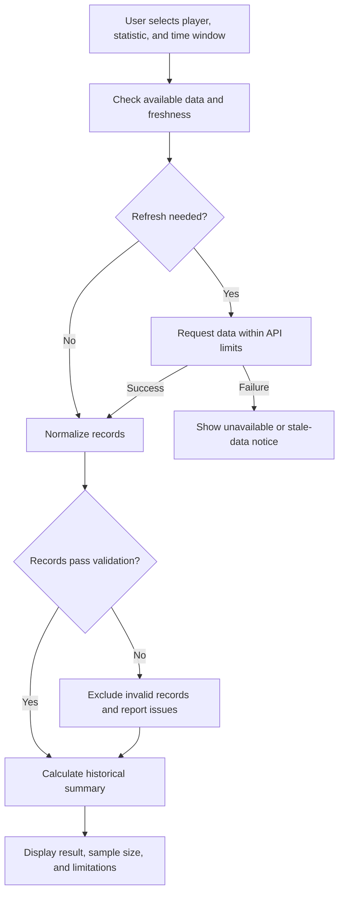

# Data Workflow & Design Decisions

## Purpose

This document describes an illustrative workflow for the public CourtsEdge showcase. It explains the reasoning behind data retrieval, validation, and analysis without exposing the private application's implementation.

The public example uses synthetic data. External API calls shown in this design are conceptual, not live integrations in this repository.
## Public Sample Behavior

The diagram below describes a broader conceptual workflow, including proposed partial-coverage handling. The public Python sample uses a stricter approach: conflicting duplicates or missing/invalid selected statistics stop the calculation for review. It does not exclude those records and continue calculating.

The sample implements historical filtering, identical-duplicate removal, window selection, value checks, and summary calculations. Live retrieval, freshness checks, and partial-coverage displays are design concepts.

## Workflow

If no eligible records remain, display “insufficient data” instead of a percentage.

## Data Preparation

Different sources can represent the same information differently. Before calculating a result, the workflow needs consistent fields.

| Field | Purpose | Validation |
|---|---|---|
| player_id | Identify the player consistently | Required; use an explicit mapping across sources |
| game_id | Identify a game | Required |
| game_date | Order and filter games | Valid date |
| game_status | Separate completed games from other events | Recognized status |
| statistic | Identify the measure, such as points | Supported measure with consistent units |
| value | Store the observed performance | Numeric and nonnegative for counting statistics |
| participation_status | Distinguish played games from nonparticipation | Explicit status; do not infer from a missing value |
| retrieved_at | Record when data was fetched | Valid timestamp with timezone |

For this example, the expected grain is one player, one game, and one statistic. That combination forms the duplicate-check key.

Identical duplicate records can be collapsed. Conflicting values for the same key require review or an explicit source-priority rule; they must not be silently averaged.

## Representative Analysis

**Question:** In a fictional player's six most recent completed games with participation, how often did the player score more than 20.5 points?

Synthetic values:

| Game, newest first | Points | Above 20.5? |
|---|---:|---|
| G006 | 24 | Yes |
| G005 | 18 | No |
| G004 | 27 | Yes |
| G003 | 21 | Yes |
| G002 | 16 | No |
| G001 | 23 | Yes |

**Calculation:** 4 qualifying games / 6 eligible games = **66.7% historical hit rate**.

The result should read:

> Scored above 20.5 points in 4 of 6 eligible games (66.7%).

This describes a synthetic historical sample. It is not a forecast or a claim of betting profitability.

### Window and Missing-Data Rules

1. Select completed games before the analysis cutoff.
2. Keep games where participation is confirmed.
3. Sort by game date, newest first, with a consistent tie-breaker.
4. Select the most recent six games.
5. Validate the selected statistics before calculating the result.

If one selected game has a missing statistic, report the missing record and coverage. Do not replace it with an older game without explaining the change.

For example: “4 of 5 games with available statistics; coverage: 5 of 6 selected games.” Do not describe this as a complete six-game result.

## Freshness and API Constraints

A refresh policy should account for the type of data:

- Completed-game statistics generally change less often than pre-game availability or odds.
- Record retrieval time separately from the provider's update time when both are available.
- A successful fetch does not guarantee that the provider's underlying data is current.
- Reuse eligible cached responses to avoid unnecessary requests.
- Respect the provider's documented request limits.
- On rate-limit responses, honor retry instructions when available and use bounded retries.
- Keep the last successful refresh time unchanged when a request fails.
- Show stale or unavailable data clearly instead of presenting a failed refresh as successful.

Exact refresh intervals and stale-data thresholds depend on the source and use case. This document does not assert a universal interval.

## Acceptance Criteria

| Scenario | Expected behavior |
|---|---|
| Same player/game/statistic appears twice identically | Count it once |
| Duplicate key has conflicting values | Flag the conflict and exclude it until resolved |
| Player has zero points and confirmed participation | Keep zero as a valid observation |
| Player did not participate | Exclude from the played-game sample |
| Selected game has a missing statistic | Flag incomplete coverage; do not turn it into zero |
| No eligible observations remain | Show insufficient data |
| API request fails | Show an error or clearly labeled cached data |
| Data is older than the defined freshness threshold | Show a stale-data notice |
| Game occurs after the analysis cutoff | Exclude it from the historical sample |

These are conceptual acceptance criteria for the broader workflow. The README documents three checks run against the public script: the baseline result, conflicting duplicates, and a missing selected statistic. Other scenarios remain unverified.

## Tradeoffs

**Smaller recent-game windows:** More responsive to recent performance, but more sensitive to individual games.

**Larger historical windows:** More observations, but may include older roles, teammates, or playing conditions.

**More frequent refreshes:** Potentially fresher information, but greater API usage and more rate-limit pressure.

**Strict validation:** May reduce available coverage, but prevents unsupported or misleading calculations.

## AI's Role

AI tools assisted with development and troubleshooting. The historical calculations described here are deterministic rules, not an LLM prediction or a trained machine-learning model.

The analyst's responsibility is to define the question, specify the rules, check the outputs, and communicate limitations.
